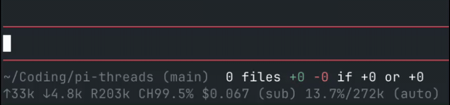
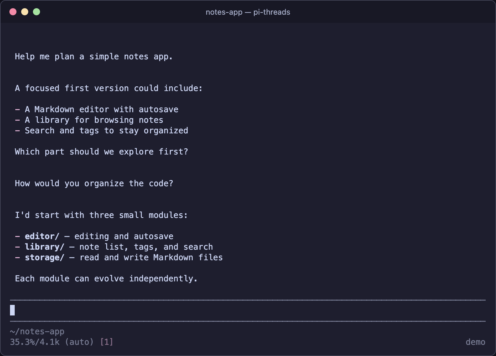
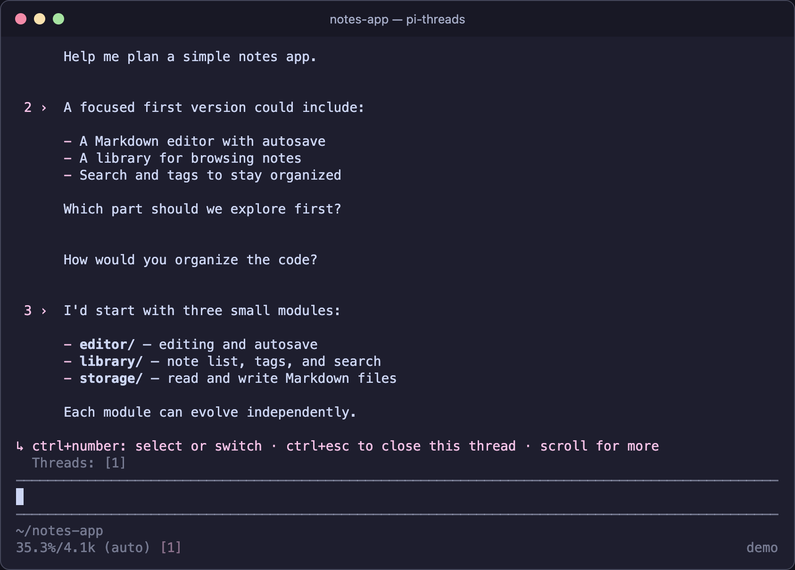
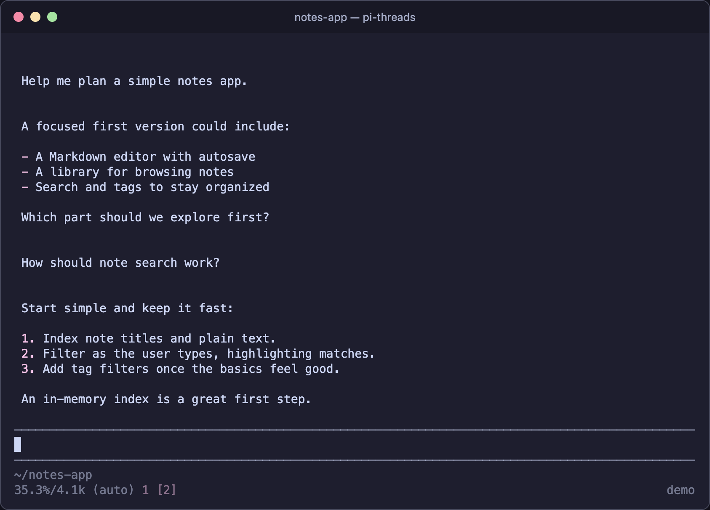
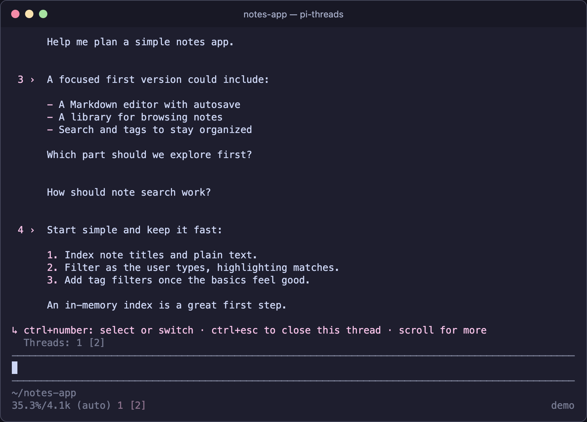

# pi-threads
Threaded side conversations that fork the existing chat at any point you choose that operates async. Tested with Ghostty, should work with Kitty's protocol, but may need to rebind (i.e. cmux)
1. Tap Ctrl to open the tree, choose a message, and reply to fork a thread.
2. Close thread with Ctrl + Esc
3. Enjoy.

## Thread activity

Hold **Ctrl** to see the thread selector: working threads pulse, completed threads with unread activity stay white, and other threads are dim. Brackets mark the current thread; press **Ctrl + number** to switch.



## Installation
Ask your clanker, or
```sh
pi install https://github.com/D3MZ/pi-threads
```

## Commands
- `/threads` — show command usage. Type `/threads ` to see available options.
- `/threads on` — show message target numbers in the current thread.
- `/threads off` — hide target numbers and cancel a pending reply. Keyboard shortcuts remain enabled.
- `/threads show` — choose a registered session from a list.
- `/threads 2` — open a registered session by number; this also works from a fork view.
- `/threads keybinding` — configure the target shortcut, modifier prefix, and previous/next shortcuts. Run `/reload` to apply changes.

## Walkthrough

**1. Normal chat**



**2. Hold Ctrl** to see numbered messages you can fork from.



**3. Press Ctrl+2**, type a reply, and press Enter to open a new thread from that message.



**4. Hold Ctrl again** to see the current thread and available targets. Press Ctrl+1 to return to the main thread, or choose another message to fork again.

